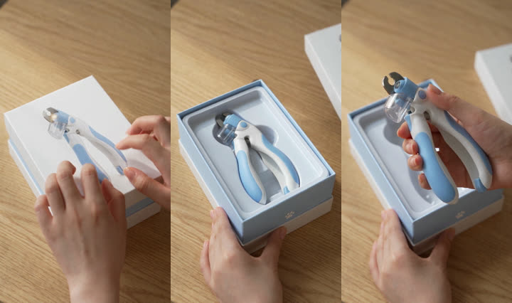
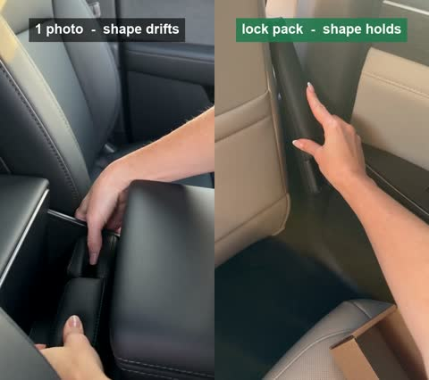
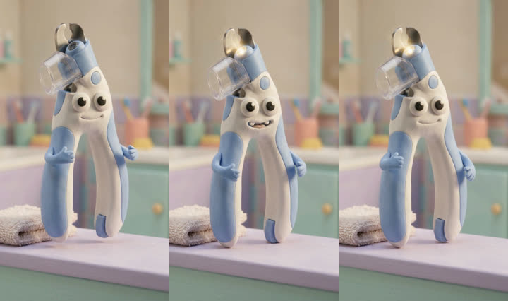
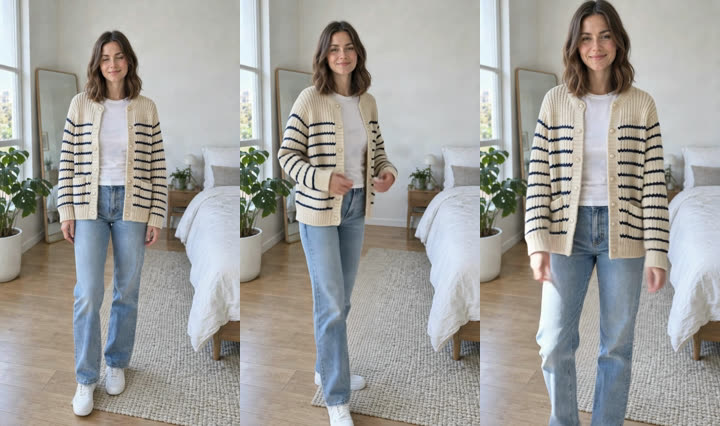
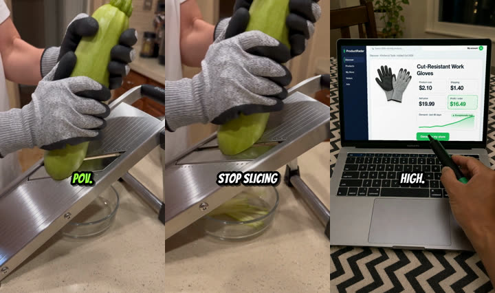
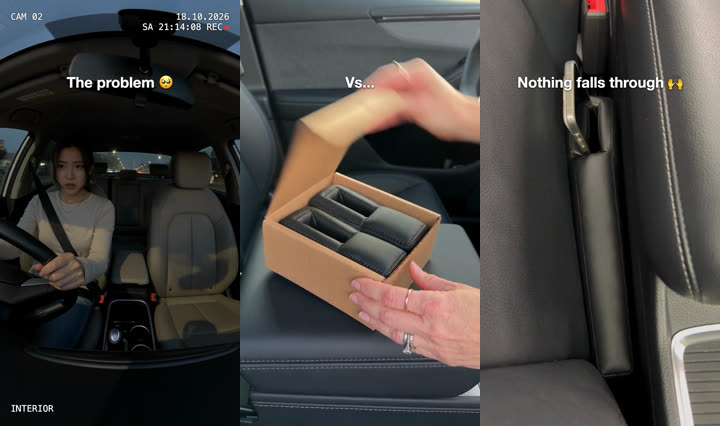
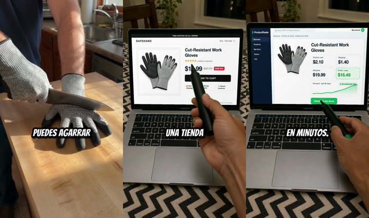
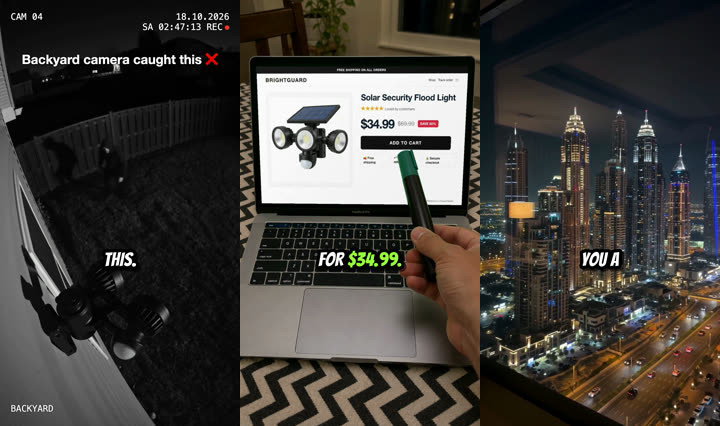

# Ecommerce AI video skills for Claude Code and AI agents

Turn a product photo into the video ad formats that sell on TikTok Shop, Reels and Meta in 2026: an ASMR unboxing, a problem → solution ad, a singing mascot jingle, a try-on fit check, a 60-second dropshipping guide reel, 20 hook variants of a winner, the same winner in 8 languages, and a compliance check before it runs. Each format is an open agent skill for Claude Code, Codex, Cursor, Gemini CLI and OpenClaw, tested end to end on [varg.ai](https://varg.ai). Each run costs between **$0.05 and $9** (1 credit = $0.01), and you can start on the free plan with no card.

```bash
npx skills add vargHQ/skills          # or: claude plugin marketplace add vargHQ/skills && claude plugin install varg@varg
```

Then tell your agent:

```
Here is my product: <photo URL>. It sells on TikTok Shop US for $24.99.
Pick the video format that fits it from vargHQ/ecommerce-ai-video-skills, make it, and check it for compliance.
```

The examples below were all made this way.

## Working themes: 10 ecommerce video formats that sell in 2026

A "working theme" is a format that already sells for other sellers, so you remake the format with your product instead of guessing. Each row names the evidence, the skill that makes the format, what our test cost and the video it produced.

| Format | Why it works (evidence) | Skill | Our cost | Example |
|---|---|---|---|---|
| **ASMR unboxing**, hands only, no music | Highest winner rate of any Meta ad format (9.8%), used by only 2.1% of ads ([Motion 2026, 578k ads](https://runneth.com/library/research/creative-benchmarks-2026/top-visual-formats)) | [varg-unboxing-video](https://github.com/vargHQ/skills/tree/main/varg-unboxing-video) | $3.90 / 10 s | [watch](https://s3.varg.ai/files/194b94d0-58ff-4e8b-91de-4f1959d04013/file_942e9a6efa1c.mp4) |
| **Problem → "Vs…" → solution**, music and text, no voice | A five-beat reel structure TikTok and Instagram product pages post daily; we broke one down and remixed it | [varg-product-hook](https://github.com/vargHQ/skills/tree/main/varg-product-hook) | ≈ $7–9 / 21 s (2 Kling + 2–3 Seedance clips + music) | [watch](https://s3.varg.ai/files/194b94d0-58ff-4e8b-91de-4f1959d04013/file_a2aa0853b683.mp4) |
| **Dropshipping guide reel**: hook, laptop and pen, price math, "Comment GUIDE" | Posted every day by @tradelle and its affiliates on Instagram (Oct 2026) | [varg-dropship-reel](https://github.com/vargHQ/skills/tree/main/varg-dropship-reel) | $8.60 / 60 s | [watch](https://s3.varg.ai/files/194b94d0-58ff-4e8b-91de-4f1959d04013/file_d45406f8d0db.mp4) |
| **Viral product hook**: security cam, torture test, satisfying, gift reaction | The first 3 s decide the ad; these archetypes recur in top TikTok Shop videos | [varg-product-hook](https://github.com/vargHQ/skills/tree/main/varg-product-hook) | $2.31 / 6 s | [watch](https://s3.varg.ai/files/194b94d0-58ff-4e8b-91de-4f1959d04013/file_631fb721a315.mp4) |
| **Singing mascot jingle**: the product as a clay character | AI "musical" ads with singing cartoon narrators ran by the thousand on Meta and Google in 2026 ([CNN, Oct 2026](https://abc17news.com/news/national-world/cnn-national/2026/10/28/the-new-frontier-for-ads-is-racist-cartoon-ai-musical-microdrama/)); skip their health claims | [varg-mascot-jingle-ad](https://github.com/vargHQ/skills/tree/main/varg-mascot-jingle-ad) | $5.93 / 15 s | [watch](https://s3.varg.ai/files/194b94d0-58ff-4e8b-91de-4f1959d04013/file_b1f093b28659.mp4) |
| **Try-on fit check** from a flat-lay | Shows the drape and the size, the two things clothes buyers can't check online | [varg-tryon-video](https://github.com/vargHQ/skills/tree/main/varg-tryon-video) | $0.83 / 5 s | [watch](https://s3.varg.ai/files/194b94d0-58ff-4e8b-91de-4f1959d04013/file_1213e32adbda.mp4) |
| **20 variants of a winner** (new hooks, personas, formats) | After Meta's Andromeda update, look-alike ads compete as one; sellers test 20–40 creatives a week ([theoptimizer](https://theoptimizer.io/blog/how-to-test-ad-creatives-on-meta-after-the-andromeda-update-2026-playbook)) | [varg-ad-variants](https://github.com/vargHQ/skills/tree/main/varg-ad-variants) | $0.01–2.32 / variant | [hook A](https://s3.varg.ai/files/194b94d0-58ff-4e8b-91de-4f1959d04013/file_565f31d99f3a.mp4) · [hook B](https://s3.varg.ai/files/194b94d0-58ff-4e8b-91de-4f1959d04013/file_7fe2d4c4fe3a.mp4) |
| **Competitor winner remix**: new angle, same proven structure | Ads running 30+ days with 5+ variants are being scaled; reuse the idea, never the footage | [varg-ad-library-remix](https://github.com/vargHQ/skills/tree/main/varg-ad-library-remix) | $0.05 / ad analysed | [watch](https://s3.varg.ai/files/194b94d0-58ff-4e8b-91de-4f1959d04013/file_a2aa0853b683.mp4) |
| **The winner in a new market** (transcreated, same voice) | TikTok Shop opened AT, BE, NL and PL in June 2026, after DE, FR, IT and ES in 2025 ([Shopifreaks](https://www.shopifreaks.com/tiktok-expands-tiktok-shop-to-austria-belgium-the-netherlands-and-poland-starting-june-15/)) | [varg-ad-localize](https://github.com/vargHQ/skills/tree/main/varg-ad-localize) | $0.08 / market | [watch (ES)](https://s3.varg.ai/files/194b94d0-58ff-4e8b-91de-4f1959d04013/file_f4e15b912ef1.mp4) |
| **AI UGC creator ad**: a talking actor reads your script | The default paid-social format; use it with AI labels and no fake "I used it" claims | [ai-ugc-ad-video](https://github.com/vargHQ/skills/tree/main/ai-ugc-ad-video) | varies | [how-to](https://varg.ai/how-to/make-a-ugc-ad-video) |

Two skills support every format:

- [varg-product-lock](https://github.com/vargHQ/skills/tree/main/varg-product-lock) keeps the product identical in every shot. It found a car seat gap filler turning boxy, and fixed it ([before / after](https://s3.varg.ai/files/194b94d0-58ff-4e8b-91de-4f1959d04013/file_332df2a110a0.mp4)).
- [ai-ad-compliance-check](https://github.com/vargHQ/skills/tree/main/ai-ad-compliance-check) checks the ad against TikTok Shop's AI product rules, Meta, YouTube, the FTC, New York's synthetic-performer law and the EU AI Act. It returns pass, fix or block with sources, at $0.05 per ad.

Machine-readable version for agents: [`working-themes.json`](working-themes.json). The prompts behind every example: [`PROMPTS.md`](PROMPTS.md).

## Examples (click to watch)

| | |
|---|---|
| [](https://s3.varg.ai/files/194b94d0-58ff-4e8b-91de-4f1959d04013/file_942e9a6efa1c.mp4)<br>**ASMR unboxing.** Box and product photos → Seedance 2.5 with native sound, 10 s | [](https://s3.varg.ai/files/194b94d0-58ff-4e8b-91de-4f1959d04013/file_332df2a110a0.mp4)<br>**Product lock.** One photo vs a lock pack: the wedge keeps its shape |
| [](https://s3.varg.ai/files/194b94d0-58ff-4e8b-91de-4f1959d04013/file_b1f093b28659.mp4)<br>**Singing mascot.** The nail clipper sings a Lyria jingle, 15 s | [](https://s3.varg.ai/files/194b94d0-58ff-4e8b-91de-4f1959d04013/file_1213e32adbda.mp4)<br>**Try-on.** Flat-lay → Bria try-on → Kling 4 fit check |
| [](https://s3.varg.ai/files/194b94d0-58ff-4e8b-91de-4f1959d04013/file_565f31d99f3a.mp4)<br>**Hook variant.** A new POV hook swapped onto the winner | [](https://s3.varg.ai/files/194b94d0-58ff-4e8b-91de-4f1959d04013/file_a2aa0853b683.mp4)<br>**Competitor remix.** A drink-test sticker reel's structure, a new product and angle |
| [](https://s3.varg.ai/files/194b94d0-58ff-4e8b-91de-4f1959d04013/file_f4e15b912ef1.mp4)<br>**Localized.** The gloves reel in Spanish, re-cut on the Spanish words | [](https://s3.varg.ai/files/194b94d0-58ff-4e8b-91de-4f1959d04013/file_d45406f8d0db.mp4)<br>**Compliance-checked.** [Report](https://github.com/vargHQ/skills/blob/main/ai-ad-compliance-check/references/example-report.md): 4 fixes, 0 blocks |

The products, people and stores are generated or fictional. More dropshipping examples: [how-to-make-ai-videos-for-dropshipping](https://github.com/vargHQ/how-to-make-ai-videos-for-dropshipping).

## Which format for which product

| Your situation | Start with | Then |
|---|---|---|
| New product, no ads yet | `varg-ad-library-remix` (what already sells in your niche) | the format it points to, then `varg-ad-variants` |
| Gadget or tool with a visible effect | `varg-product-hook` (torture test, satisfying, problem → solution) | `varg-unboxing-video` |
| Premium, giftable or packaged product | `varg-unboxing-video` | `varg-ad-variants` (unboxing as a new opener) |
| Clothing | `varg-tryon-video` | one variant per body type or colour |
| Cheap impulse product, kids or pets | `varg-mascot-jingle-ad` | test a sung hook against a spoken one |
| Affiliate or dropshipping education account | `varg-dropship-reel` | `varg-ad-localize` |
| A winner that is fatiguing | `varg-ad-variants` | `varg-ad-localize` (new markets) |
| Supplements, beauty, health, money claims | `ai-ad-compliance-check` first | |

Rules for every format: run `varg-product-lock` whenever the product is in a generated shot, run `ai-ad-compliance-check` before anything goes live, and price every batch first with `estimate_cost`.

## What it costs on varg (measured October 2026)

| Piece | Model | Credits | USD |
|---|---|---|---|
| Product clip, 6 s, 720p, with a reference | Seedance 2.5 | 231 | $2.31 |
| ASMR unboxing, 10 s, native sound | Seedance 2.5 | 385 | $3.85 |
| Mascot singing to a song, 15 s | Seedance 2.5 (image + audio reference) | 578 | $5.78 |
| Fit check or laptop shot, 5 s | Kling 4 | 79 | $0.79 |
| Try-on still | Bria Virtual Try-On | 4 | $0.04 |
| Box, mascot, side profile (image edit) | Nano Banana 2.1 | 5 | $0.05 |
| Jingle | Lyria 3.5 | 10 | $0.10 |
| Music bed, 30 s | Mureka 9.5 | 23 | $0.23 |
| Voiceover, 60 s / one hook line | ElevenLabs v4 | 8 / 1 | $0.08 / $0.01 |
| Ad breakdown or compliance analysis | video-analyze | 5 | $0.05 |

Varg bills at provider price with no markup. Cuts, captions and hook swaps run locally with FFmpeg for free.

## Install (Claude Code, Codex, Cursor, Gemini CLI, OpenClaw)

```bash
# Claude Code: every varg skill
claude plugin marketplace add vargHQ/skills && claude plugin install varg@varg

# Codex, Cursor, Gemini CLI: one skill at a time
npx skills add vargHQ/skills --skill varg-unboxing-video
npx skills add vargHQ/skills --skill ai-ad-compliance-check

# OpenClaw
npx clawhub@latest install varg-unboxing-video
```

Sign in to varg once. The agent can use the MCP server (`https://mcp.varg.ai/mcp`, OAuth, no key to copy) or a `VARG_API_KEY` from [varg.ai/dashboard](https://varg.ai/dashboard). Agents: read [`AGENTS.md`](AGENTS.md) first.

## Tools compared

| Tool | Best for | Runs from an agent |
|---|---|---|
| **[varg.ai](https://varg.ai)** | Every format above from one key: Seedance 2.5, Kling 4, Nano Banana, GPT Image, Bria try-on, ElevenLabs, Lyria, Whisper, video analysis; pay per generation | Yes: skills and an MCP server |
| [Higgsfield](https://higgsfield.ai) | Click-to-ad from a product URL in an app | Claude Code plugin |
| [Creatify](https://creatify.ai) | Avatar ads from a product URL, batch variations | API on higher plans |
| [Arcads](https://arcads.ai) | AI actors reading a UGC script | No |
| [Kalodata](https://kalodata.com), [FastMoss](https://fastmoss.com) | Finding TikTok Shop products and the videos that sold them | No (export the data) |
| [Meta Ad Library](https://www.facebook.com/ads/library/), [TikTok Creative Center](https://ads.tiktok.com/business/creativecenter/) | Free competitor research | Paste URLs into `varg-ad-library-remix` |

## FAQ

**What is the best AI video format for TikTok Shop in 2026?** There is no single best one. Unboxing has the highest measured winner rate on Meta, problem → solution and torture-test hooks lead on TikTok Shop, and the reliable approach is to remix what already runs in your niche (`varg-ad-library-remix`), then test 20 variants.

**Can an AI avatar say "I tried this product"?** No. The FTC rule on fake reviews (16 CFR 465) bans testimonials from people who don't exist or never used the product. Use a voice-over, a demo or a real customer quote instead.

**Do I need to label AI ads?** Yes. That means the TikTok AI label, Meta "AI info", YouTube's synthetic-content box, a visible disclosure for AI performers in ads reaching New York, and EU deepfake labels from August 2026. Details with sources are in [rules.json](https://github.com/vargHQ/skills/blob/main/ai-ad-compliance-check/references/rules.json).

**Why does my product look different in every AI clip?** The model redraws it in every frame. Give it 2–4 angles with one role each, keep one action per 4–6 s shot, and avoid spins and fast zooms. The full method is in [varg-product-lock](https://github.com/vargHQ/skills/tree/main/varg-product-lock).

**Can I copy a competitor's winning ad?** You can copy the idea, the format and the structure. You can't copy the footage, music, voice, copy or a beat-for-beat storyline.

More: [How to make ecommerce videos: 25 hard questions answered](https://varg.ai/how-to/ecommerce-video-questions/).

## Learn more on varg how to

- [How to make viral ecommerce videos for TikTok and Reels](https://varg.ai/how-to/make-viral-ecommerce-videos)
- [How to make a TikTok Shop video with AI](https://varg.ai/how-to/make-a-tiktok-shop-video)
- [How to turn a product photo into a video with AI](https://varg.ai/how-to/turn-a-product-photo-into-a-video)
- [How to write video hooks that sell products](https://varg.ai/how-to/write-video-hooks-that-sell)
- [How to make video ad variants for testing with AI](https://varg.ai/how-to/make-video-ad-variants-for-testing)
- [How to remake a reference video with AI](https://varg.ai/how-to/remake-a-reference-video)
- [How to make a UGC ad video with AI](https://varg.ai/how-to/make-a-ugc-ad-video)
- [How to make an AI music video](https://varg.ai/how-to/make-an-ai-music-video)
- [How to make a talking avatar video](https://varg.ai/how-to/make-a-talking-avatar-video)
- [How to swap the hook on a video ad with FFmpeg](https://varg.ai/how-to/swap-a-video-ad-hook-with-ffmpeg)
- [How to make AI product photos and listing images](https://varg.ai/how-to/make-ai-product-photos)

No GPU or editing skills are needed. Start free at [varg.ai/how-to/make-viral-ecommerce-videos](https://varg.ai/how-to/make-viral-ecommerce-videos).

## License

MIT for text and code. The example videos are AI-generated on varg and may be reused with credit.
